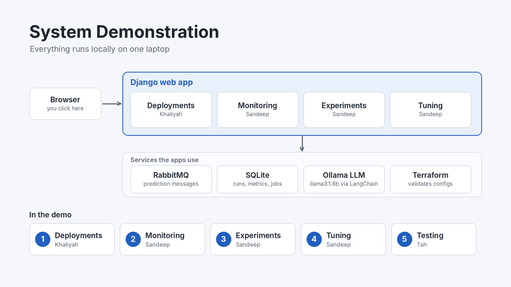
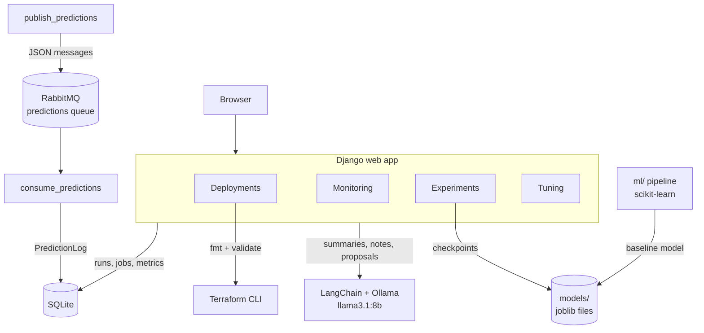
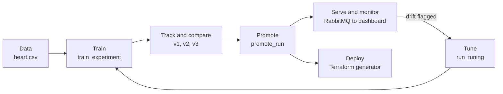
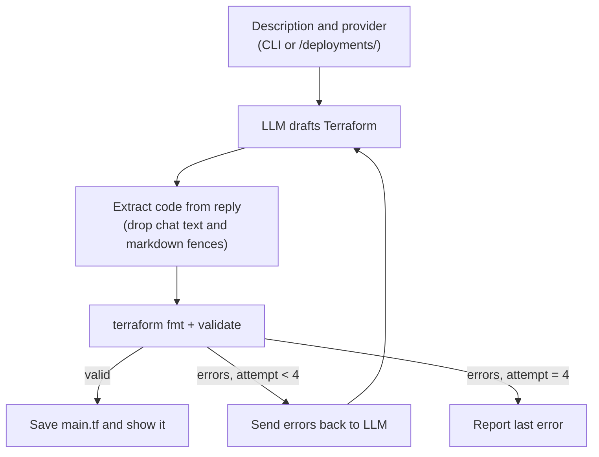
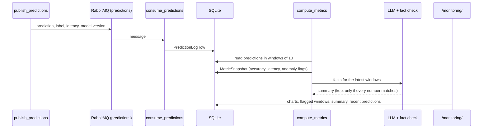
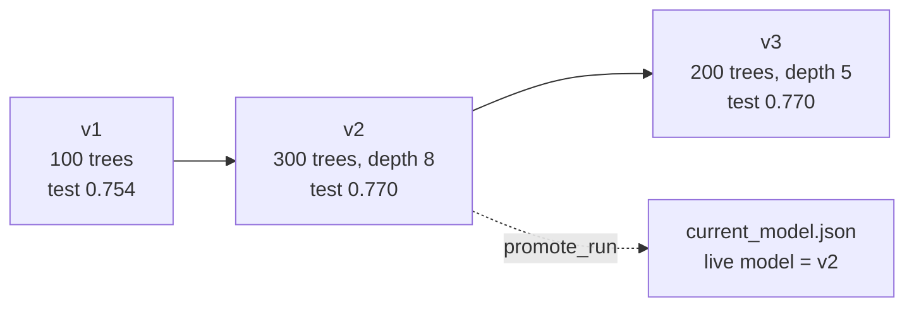
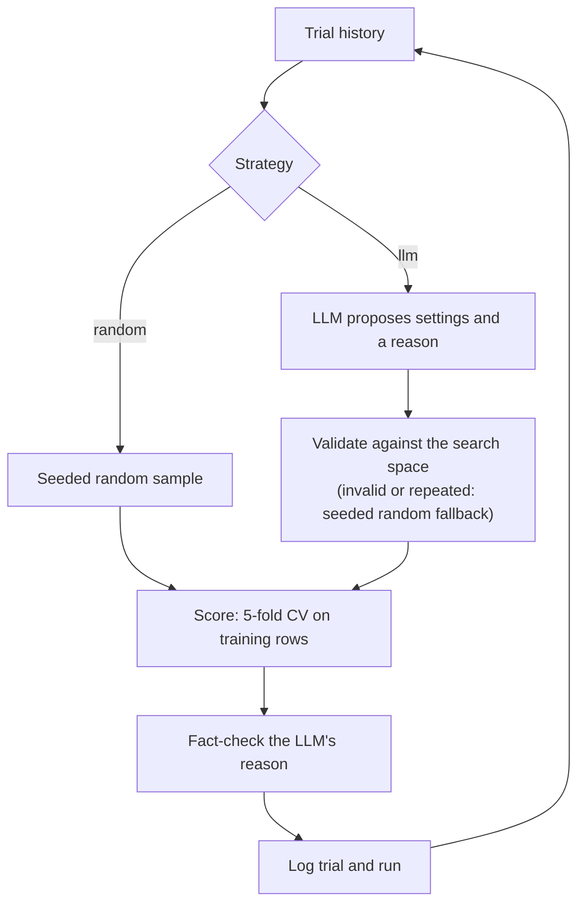
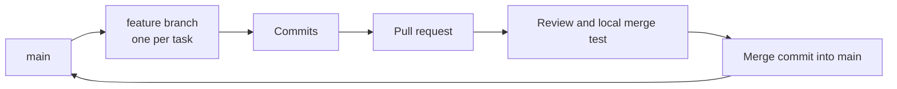

# AutoMLOps Suite

**An AI-assisted MLOps platform built with Django, LangChain and Python.** It covers the full machine learning lifecycle: deployment, monitoring, experiment tracking, hyperparameter tuning and testing. The lifecycle is demonstrated on a heart-disease classifier.

Team **Gen 5**: Khaliyah S. Paen · Sandeep Shah · Tah Soh. Course project, Morgan State University, Fall 2026.

**Live demo:** [gen-5-project.onrender.com](https://gen-5-project.onrender.com). This is a read-only snapshot of real project data. The free host sleeps when idle, so the first visit can take about a minute to load.



---

## Table of contents

1. [Abstract](#abstract)
2. [Problem statement and objectives](#1-problem-statement-and-objectives)
3. [System architecture](#2-system-architecture)
4. [Dataset](#3-dataset)
5. [Methodology (assignment steps 1–6)](#4-methodology-assignment-steps-16)
6. [Results and evaluation metrics](#5-results-and-evaluation-metrics)
7. [Installation and usage](#6-installation-and-usage)
8. [Repository structure](#7-repository-structure)
9. [Team and contributions](#8-team-and-contributions)
10. [Live demo deployment](#9-live-demo-deployment)
11. [Limitations and future work](#10-limitations-and-future-work)
12. [Use of AI tools](#11-use-of-ai-tools)
13. [References](#12-references)

---

## Abstract

Most machine learning projects end at a single accuracy score. Production systems also need repeatable training, versioned models, monitoring of live predictions, systematic tuning and safe deployment. AutoMLOps Suite implements these stages in one Django application. A large language model (LLM) assists every stage through LangChain:

- writing Terraform deployment configurations,
- summarising monitoring windows,
- describing changes between model versions,
- proposing hyperparameters.

LLM output is never trusted directly. Every response is validated, either by the Terraform validator or by a fact check against the computed metrics, and a deterministic fallback takes over when the check fails.

On the Kaggle heart-disease data (302 unique records after removing duplicates), the baseline random forest reached **0.754** test accuracy. Tracked experiments improved this to **0.770**, and that version was promoted. Monitoring on held-out data reports about **0.80** accuracy and flags windows with simulated drift. LLM-guided tuning **tied** random search, with both reaching **0.8504** cross-validation accuracy in 15 trials. The suite has **204 automated tests** with **94% code coverage**.

---

## 1. Problem statement and objectives

The assignment asks for an "AutoMLOps Suite" that automates and supports the main operational stages of a machine learning model with AI assistance. We organised the work around the assignment's six steps:

| Step | Objective | Implementation | Owner |
|---|---|---|---|
| 1. Setup and environment | Reproducible project, data pipeline and baseline model | `config/`, `core/`, `ml/`, `docker-compose.yml` | Khaliyah (pipeline), Sandeep (Django base) |
| 2. AI-powered model deployment | Generate validated cloud infrastructure for the model | `deployment/` (CLI and `/deployments/` page) | Khaliyah (generator), Sandeep (page, output fix) |
| 3. Intelligent model monitoring | Stream predictions, detect degradation, explain it | `monitoring/` (RabbitMQ pipeline and `/monitoring/`) | Sandeep |
| 4. Integrated experiment tracking | Version every training run, compare and promote | `experiments/` (`/experiments/`) | Sandeep |
| 5. Automated hyperparameter tuning | LLM-guided search compared with a random baseline | `tuning/` (`/tuning/`) | Sandeep (originally assigned to Tah) |
| 6. Testing and optimization | Verify the whole suite and measure performance | `core/test_*.py`, `experiments/test_lifecycle.py`, `docs/TESTING.md` | Tah |

---

## 2. System architecture



| Layer | Technology |
|---|---|
| Web framework | Django 4.2 (apps: `core`, `deployment`, `monitoring`, `experiments`, `tuning`) |
| Machine learning | scikit-learn (Pipeline: median imputation, standard scaling, random forest), pandas, joblib |
| LLM integration | LangChain with Ollama (local `llama3.1:8b`), or OpenAI (`gpt-4o-mini`) through `core/llm.py` |
| Messaging | RabbitMQ 3 (Docker, management UI on port 15672), `pika` client |
| Infrastructure as code | Terraform CLI for formatting and validating generated AWS and GCP configs |
| Storage | SQLite (runs, metrics, jobs, predictions); model files in `models/` |
| Testing | Django test runner, `coverage`, custom `benchmark` command |
| Demo hosting | Render (gunicorn and WhiteNoise, read-only snapshot) |

The model lifecycle the suite supports:



---

## 3. Dataset

| Property | Value |
|---|---|
| Source | [Heart Disease Dataset](https://www.kaggle.com/datasets/johnsmith88/heart-disease-dataset) (Kaggle, D. Lapp), derived from the UCI Heart Disease databases (Cleveland, Hungary, Switzerland, Long Beach V) |
| File in repo | `ml/data/heart.csv` |
| Rows | 1,025 |
| Duplicate rows removed | 723 (70.5%) |
| Unique rows used | 302 |
| Columns | 13 features and 1 binary label (`target`) |
| Missing values | None |
| Class balance (unique rows) | 164 positive, 138 negative |
| Split | Stratified 80/20, `random_state=42`: 241 training rows, 61 test rows |

| Feature | Meaning |
|---|---|
| `age` | Age in years |
| `sex` | 1 = male, 0 = female |
| `cp` | Chest pain type (0–3) |
| `trestbps` | Resting blood pressure (mm Hg) |
| `chol` | Serum cholesterol (mg/dl) |
| `fbs` | Fasting blood sugar above 120 mg/dl (1 = true) |
| `restecg` | Resting electrocardiogram result (0–2) |
| `thalach` | Maximum heart rate achieved |
| `exang` | Exercise-induced angina (1 = yes) |
| `oldpeak` | ST depression induced by exercise relative to rest |
| `slope` | Slope of the peak exercise ST segment |
| `ca` | Number of major vessels coloured by fluoroscopy |
| `thal` | Thalassemia (encoded category) |

**Preprocessing** (`ml/preprocesss.py`, `ml/train_model.py`): load the CSV, drop duplicate records, separate features from `target`, then split with stratification. Median imputation and standard scaling sit inside the scikit-learn `Pipeline`, so they are fitted on training rows only.

**Why the duplicates matter:** without deduplication, copies of test rows also appear in training, which inflates accuracy. Every result below uses the 302 unique rows.

> The model is a teaching example. It supports research and decision-making demonstrations and is not a medical diagnostic tool.

---

## 4. Methodology (assignment steps 1–6)

### 4.1 Step 1: Setup and environment

- **Django project:** `config/` holds settings, which are loaded from `.env`, and URLs. `core/` provides the home page, shared templates and `core/llm.py`.
- **`get_llm()`:** one function returns a LangChain chat model for either provider (`LLM_PROVIDER=ollama` or `openai`), so no other app depends on a specific vendor.
- **RabbitMQ:** `docker-compose.yml` starts `rabbitmq:3-management` (ports 5672 and 15672).
- **Baseline pipeline:** in `ml/`, `train_model.py`, `evaluate_model.py` and `generate_graphs.py` produce the baseline model, its metrics (`assets/evaluation_results.json`), a confusion matrix and a feature-importance chart.
- **Dependencies:** pinned in `requirements.txt`.

### 4.2 Step 2: AI-powered model deployment

The user describes the infrastructure in plain English and chooses AWS or GCP. The LLM drafts Terraform, and the Terraform CLI formats and validates it. Validation errors go back to the LLM for correction, up to 4 attempts. The tool **generates configuration only**; it does not apply it to a cloud account.



- **CLI:** `python -m deployment.cli --provider aws --description "..." --output generated/test`
- **Web:** `/deployments/` shows the result, attempts, time taken, the generated `main.tf` and the sample configs in `generated/aws/` and `generated/gcp/`. Only staff can generate.
- **Engineering finding:** the local model wrapped its answer in chat text and markdown fences, so the first version failed validation on all 4 attempts. Adding `extract_terraform_code()` fixed this (see results).

### 4.3 Step 3: Intelligent model monitoring



- Predictions use **held-out test rows only**. An early version sampled training rows and reported 94%, a misleading figure caused by data leakage.
- **Accuracy anomaly:** window accuracy more than 0.10 below the 0.75 baseline.
- **Latency anomaly:** window latency more than double the earlier median.
- `--drift` flips each prediction with 40% probability in the second half of the run, simulating a model that has started to degrade. The dashboard should then flag those windows.
- **LLM summaries:** the model runs at temperature 0, code writes the opening sentence, and a fact check compares every number in the summary with the computed metrics. If the check fails, a summary written by code is shown instead.

### 4.4 Step 4: Integrated experiment tracking



- Every run is stored as a numbered version with its parameters, training and test metrics, the parent version, the changes from the parent, a SHA-256 hash of the data, the git commit and the checkpoint path.
- The LLM writes a version note describing the change. A guard rejects notes that contradict the recorded parameters.
- Pages: experiment list, run detail, side-by-side compare with **Explain the difference** (with a fallback written by code), and **Promote** (staff only). Promote works like a `git checkout`: it writes `models/current_model.json`, and monitoring reads that file.
- `log_run()` in `experiments/tracking.py` is the shared logging API. Tuning trials are logged through it.

### 4.5 Step 5: Automated hyperparameter tuning



- **Search space:** random forest parameters `n_estimators` (50–500), `max_depth`, `min_samples_split`, `min_samples_leaf` and `max_features`.
- **Selection** uses only cross-validation accuracy on training rows. Test accuracy is shown for reference and never used to choose settings.
- Random fallbacks use their own seeded stream, so jobs are reproducible.
- **Web:** `/tuning/` (jobs), `/tuning/<id>/` (trials), `/tuning/compare/` (LLM against random). **Suggest next experiments** asks the LLM for 3 new configurations; repeated or invalid ones are replaced and labelled. **Try this** runs one more trial.

### 4.6 Step 6: Testing and optimization

- **Unit and view tests** for every app, with the LLM, RabbitMQ and Terraform mocked.
- **Smoke tests** (`core/test_smoke.py`) open the main pages, both logged out and as staff.
- **Integration tests** (`experiments/test_lifecycle.py`): training registers versioned runs that the compare page reads; prediction messages are stored and turned into dashboard metrics; a deployment result is saved and shown (generator mocked).
- **Demo tests** (`core/test_demo.py`) check that every page returns 200 with `DEBUG=False` and every external service unavailable.
- **Benchmark:** `python manage.py benchmark` measures response time and SQL query counts per page (`core/test_performance.py`, `docs/benchmarks/`).
- **Optimization review:** the dashboard uses 4 queries, each serving separate data, and no N+1 pattern was found. No code was changed for speed, and no before/after claim is made. Details are in [`docs/TESTING.md`](docs/TESTING.md).

### 4.7 How LLM output is kept honest

| Where the LLM is used | Check applied | Fallback |
|---|---|---|
| Terraform generation | `terraform validate`, up to 4 attempts | Last error and last generated `main.tf` shown |
| Monitoring summary | Every number compared with computed metrics | Summary written by code |
| Version notes and compare explanation | Compared with the recorded parameters and metrics | Text written from the numbers |
| Tuning proposals | Search-space validation and repeat detection | Seeded random configuration, labelled |
| Tuning reasons | Fact check against the previous trial (the best trial for suggestions) | Reason replaced and flagged |

---

## 5. Results and evaluation metrics

All numbers were measured by the team on the 302-row deduplicated dataset.

### 5.1 Model performance (test set, 61 rows)

| Version | Settings | Train accuracy | Test accuracy | Test precision | Test recall | Test F1 | Train–test gap |
|---|---|---:|---:|---:|---:|---:|---:|
| v1 (baseline) | 100 trees, no depth limit | 1.000 | 0.754 | 0.765 | 0.788 | 0.776 | 0.246 |
| **v2 (promoted)** | 300 trees, max depth 8 | 1.000 | **0.770** | 0.788 | 0.788 | 0.788 | 0.230 |
| v3 | 200 trees, max depth 5 | 0.950 | 0.770 | 0.788 | 0.788 | 0.788 | 0.180 |

v1 overfits, scoring perfectly on training data. v2 improved test accuracy and was promoted. v3 matched v2 with less overfitting.

### 5.2 Monitoring

| Run | Predictions | Windows | Flagged windows | Overall accuracy | Average latency |
|---|---:|---:|---:|---:|---:|
| Held-out rows, no drift | 150 | 15 | 2 | 0.81 | 9.3 ms |
| Held-out rows, then `--drift` | 300 | 30 | 4 | 0.79 | 6.7 ms |
| Early version (training rows, leaked) | n/a | n/a | n/a | 0.94 (invalid) | n/a |

### 5.3 Hyperparameter tuning (15 trials each, 5-fold CV)

| Strategy | Best CV accuracy | Found at trial | Test accuracy of best (reference) | Notes |
|---|---:|---:|---:|---|
| LLM-guided (llama3.1:8b) | 0.8504 ± 0.0640 | 2 | 0.7705 | 14 LLM proposals, 1 random fallback; 8 of 14 reasons failed the fact check; 108 s |
| Random search (seeded) | 0.8504 ± 0.0598 | 3 | 0.7869 | Much faster: 15 trials in about 10.5 s |

**Finding:** on this small dataset the search space is flat (most settings score 0.82–0.85), so the LLM gave no advantage over random search. We report this as measured and do not claim the speed-ups suggested in the assignment brief.

### 5.4 AI-powered deployment

| Version | Valid configurations | Detail |
|---|---|---|
| Before the output fix | 0 of 4 attempts | LLM reply included chat text and markdown fences |
| After the fix (CLI) | Valid on attempt 3 | Attempts 1–2 had real Terraform errors that the LLM corrected |
| After the fix (web page) | Valid on attempt 1 | 52.9 s, prompt "Serve the heart disease model as a REST API on one small server" |
| Saved samples | AWS and GCP both valid | `generated/aws/main.tf`, `generated/gcp/main.tf` |

### 5.5 Testing and performance

| Metric | Value |
|---|---|
| Automated tests | 204, all passing |
| Code coverage | 94% (1,995 statements, 111 not covered) |
| Full test run | About 25 s on a MacBook Air |
| Page response time | 0.6–5.4 ms median per page; monitoring dashboard about 6 ms median, 11 ms p95 (Django test client, SQLite; `docs/benchmarks/`, `docs/TESTING.md`) |
| Database queries on the dashboard | 4 per request, no N+1 pattern |

### 5.6 Discussion

- **Honest evaluation changed the results.** Removing duplicate rows, and keeping monitoring on held-out data, lowered headline numbers (94% → about 80%) but made them trustworthy.
- **LLMs helped most as assistants with a validator.** Terraform validation and numeric fact checks turned unreliable LLM output into dependable features.
- **LLM-guided tuning did not beat random search** on 302 rows. A larger dataset with a less flat search space is needed to test that claim fairly.

---

## 6. Installation and usage

### 6.1 Prerequisites

| Tool | Purpose | Install (macOS) |
|---|---|---|
| Python 3.10+ | Runtime (tested on 3.10 and 3.12) | `brew install python@3.10` |
| Docker Desktop | RabbitMQ for monitoring | [docker.com](https://www.docker.com/products/docker-desktop/) |
| Ollama | Local LLM | `brew install ollama`, then `ollama pull llama3.1:8b` |
| Terraform CLI | Validating generated deployment configs | `brew tap hashicorp/tap && brew install hashicorp/tap/terraform` |
| Git | Version control | `xcode-select --install` |

Without Ollama the suite still runs: every LLM feature falls back to text written by code.

### 6.2 Setup

```bash
git clone https://github.com/khpae1-beep/gen-5-project.git
cd gen-5-project
python3 -m venv .venv
source .venv/bin/activate
pip install -r requirements.txt
cp .env.example .env            # then edit LLM settings if needed
python manage.py migrate
python manage.py createsuperuser   # needed for staff-only buttons
docker compose up -d               # RabbitMQ
python manage.py runserver         # http://127.0.0.1:8000
```

### 6.3 Environment variables

| Variable | Default | Purpose |
|---|---|---|
| `LLM_PROVIDER` | `ollama` | `ollama` or `openai` |
| `LLM_MODEL` | `llama3.2` for Ollama, `gpt-4o-mini` for OpenAI (we use `llama3.1:8b`) | Model name for the provider |
| `OLLAMA_BASE_URL` | `http://localhost:11434` | Ollama server URL |
| `OPENAI_API_KEY` | (none) | Only when `LLM_PROVIDER=openai` |
| `RABBITMQ_HOST` | `localhost` | RabbitMQ host |
| `DJANGO_DEBUG` | `True` | Set `False` in production; also turns off the debug toolbar. The older name `DEBUG` also works |
| `DJANGO_SECRET_KEY` | development key | Set a long random value in production. The older name `SECRET_KEY` also works |
| `DJANGO_ALLOWED_HOSTS` | `localhost,127.0.0.1` | Comma-separated host names |
| `DJANGO_CSRF_TRUSTED_ORIGINS` | (none) | Comma-separated origins allowed to submit forms, e.g. `https://example.com` |
| `DB_PATH` | `db.sqlite3` in the project folder | SQLite file location |

On Render, the service's own host name (`RENDER_EXTERNAL_HOSTNAME`, set by Render) is added to the allowed hosts and trusted origins automatically.

### 6.4 Running each part

```bash
# Step 1: baseline pipeline
python ml/preprocesss.py
python ml/train_model.py      # overwrites models/heart_disease_model.joblib: run promote_run again afterwards
python ml/evaluate_model.py

# Step 2: AI-powered deployment
python -m deployment.cli --provider aws --description "Serve the heart disease model as a REST API on one small server" --output generated/test

# Step 3: monitoring (consumer in a second terminal)
python manage.py consume_predictions
python manage.py publish_predictions --count 100
python manage.py publish_predictions --count 50 --drift
python manage.py compute_metrics

# Step 4: experiment tracking
python manage.py train_experiment --n-estimators 300 --max-depth 8   # logged as the next version
python manage.py promote_run heart-disease-rf 2                      # serve version 2

# Step 5: hyperparameter tuning
python manage.py run_tuning --strategy random --trials 15
python manage.py run_tuning --strategy llm --trials 15

# Step 6: tests, coverage and benchmark
python manage.py test
python -m coverage run manage.py test
python -m coverage report
python manage.py benchmark
```

Use `python -m coverage`, not plain `coverage`. Plain `coverage` can run under a different Python install that cannot see Django, and then reports 0%.

### 6.5 Main pages

| Page | URL |
|---|---|
| Home | `/` |
| Deployments | `/deployments/` |
| Monitoring dashboard | `/monitoring/` |
| Experiments | `/experiments/` |
| Tuning jobs and comparison | `/tuning/`, `/tuning/compare/` |
| Admin | `/admin/` |

---

## 7. Repository structure

```text
gen-5-project/
├── config/            Django settings and URLs
├── core/              Home page, shared LLM helper, smoke/demo/performance tests, benchmark command
├── deployment/        Terraform generator (CLI + /deployments/ page)
├── monitoring/        RabbitMQ publisher/consumer, metrics, anomaly rules, dashboard
├── experiments/       Experiment and Run models, training, versioning, promotion, lifecycle test
├── tuning/            Search space, scoring, LLM proposer, reason check, tuning pages
├── ml/                Baseline pipeline (preprocessing, training, evaluation, graphs) and data/heart.csv
├── assets/            Confusion matrix, feature importance, evaluation_results.json
├── generated/         Sample Terraform configs (aws/, gcp/)
├── demo/              Read-only database snapshot for the live demo
├── bin/               render_start.sh (live demo start script)
├── docs/              demo.gif, TESTING.md, benchmarks/
├── templates/         Base layout and home page
├── docker-compose.yml RabbitMQ
├── requirements.txt   Pinned dependencies
└── .env.example       Environment variable template
```

---

## 8. Team and contributions

| Member | GitHub | Commits | Contributions |
|---|---|---:|---|
| Khaliyah S. Paen | [@khpae1-beep](https://github.com/khpae1-beep) | 6 | Step 1 data and ML pipeline (preprocessing, training, evaluation, charts, dataset); Step 2 AI-powered Terraform deployment generator and CLI; repository owner |
| Sandeep Shah | [@sande231](https://github.com/sande231) | 70 | Django base project and RabbitMQ setup; Step 3 monitoring; Step 4 experiment tracking; Step 5 hyperparameter tuning (took over from Tah, who had no laptop); deployment web page and LLM-output fix; live demo deployment; integration and code review |
| Tah Soh | [@Zagadad237](https://github.com/Zagadad237) | 5 | Step 6 testing and optimization: smoke tests, lifecycle integration tests, benchmark command, coverage configuration, performance analysis and `docs/TESTING.md` (done from a library computer with GitHub Codespaces) |

Commits are non-merge commits on all branches, from `git shortlog -sn --all --no-merges`.

### Git workflow



- One feature branch per task (for example `feature/member2-monitoring`, `feature/tuning-ui`, `feature/deployment-app`, `feature/member3-testing`).
- Every change reached `main` through a pull request merged with a merge commit, so each member's commits stay visible in the history.
- Before merging a teammate's branch, it was test-merged locally on a throwaway branch and the full test suite was run.

---

## 9. Live demo deployment

The live demo runs on Render's free tier from this repository at **https://gen-5-project.onrender.com**:

- **Build command:** `pip install -r requirements.txt && python manage.py collectstatic --noinput`
- **Start command:** `bash bin/render_start.sh`. It copies `demo/demo.sqlite3` to `DB_PATH`, runs migrations and starts gunicorn.
- **Environment:** `PYTHON_VERSION=3.12.3`, `DJANGO_DEBUG=False`, a random `DJANGO_SECRET_KEY` and `DB_PATH=/tmp/demo.sqlite3`.

The start script refuses to run without `DB_PATH`, so it never overwrites a local `db.sqlite3`. Render's own host name is allowed automatically; for a custom domain, set `DJANGO_ALLOWED_HOSTS` and `DJANGO_CSRF_TRUSTED_ORIGINS`. To try the same setup locally:

```bash
DJANGO_DEBUG=False python manage.py collectstatic --noinput
DB_PATH=/tmp/demo.sqlite3 PORT=8000 DJANGO_DEBUG=False bash bin/render_start.sh
```

The snapshot contains real project data (experiments, tuning jobs, predictions and monitoring windows) with all user accounts removed. Visitors cannot log in, so the promote, suggest and generate actions are disabled. LLM features need a local Ollama and show their fallbacks online. The demo resets to the snapshot whenever the service restarts.

---

## 10. Limitations and future work

**Limitations**

- Small dataset (302 unique rows), so differences of about 0.02 in accuracy are within noise (CV standard deviation ±0.06).
- Generated Terraform is validated but has not been applied to a live cloud account.
- SQLite and a single machine; no concurrency or load testing.
- A local 8B-parameter LLM is slow and its output often fails the fact checks. The safeguards keep features correct but limit the LLM's value.

**Future work**

- Apply generated configurations in a sandbox AWS or GCP account and serve the model as an API.
- Retrain automatically when monitoring flags drift, then compare and promote through experiment tracking.
- Evaluate LLM-guided tuning on larger datasets and stronger models.
- Run the test suite in GitHub Actions on every pull request.
- PostgreSQL, user roles, and email or Slack alerts for flagged windows.

---

## 11. Use of AI tools

We used AI coding assistants (Claude Code and GitHub Copilot) to help write and review code, tests and documentation. Commits made with Claude Code carry a `Co-Authored-By: Claude` trailer. Team members designed the features, reviewed and tested every change, and are responsible for the results reported here. The LLM inside the application (Ollama `llama3.1:8b` through LangChain) is a component of the system, as described in section 4.7.

---

## 12. References

1. D. Lapp, *Heart Disease Dataset*, Kaggle. https://www.kaggle.com/datasets/johnsmith88/heart-disease-dataset
2. A. Janosi, W. Steinbrunn, M. Pfisterer, R. Detrano, *Heart Disease*, UCI Machine Learning Repository, 1988. https://archive.ics.uci.edu/dataset/45/heart+disease
3. Django documentation. https://docs.djangoproject.com/en/4.2/
4. LangChain documentation. https://python.langchain.com/
5. scikit-learn: Pedregosa et al., "Scikit-learn: Machine Learning in Python," *JMLR* 12, 2011. https://scikit-learn.org/
6. RabbitMQ documentation. https://www.rabbitmq.com/docs
7. Terraform documentation. https://developer.hashicorp.com/terraform/docs
8. Ollama. https://ollama.com/
